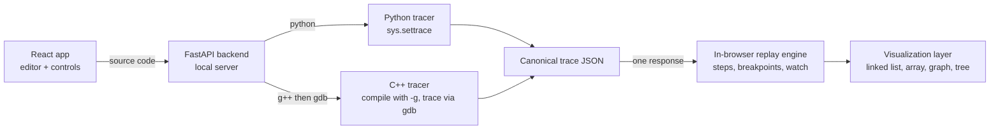

# Code Visualizer — Build Plan (v2)

An interactive web platform that takes unmodified source code (Python, C++) and renders its runtime execution: memory, pointers, heap, and data structures, with forward/backward stepping.

- Repo: `github.com/abdelrahman-ah1/code-visualizer` (private until the project is done)
- Pace: ~2 hours/day, no deadline
- Status: Milestone 1 done (Python tracer pack on `main`)

---

## 1. Goals

This one project serves four purposes, in order of arrival:

1. **Course project** — strong, demonstrable systems work.
2. **Portfolio piece** — a polished repo with a README that explains the design.
3. **Graduation project** — the final milestone (MSA CS405/CS406 track: proposal, prototype, evaluation, thesis).
4. **Product** — usable by other students and teachers once hosted.

## 2. Audience

- **Students** learning data structures and algorithms.
- **Teachers** demonstrating how code executes.
- **Interviewers** walking through a candidate's algorithm.

Python Tutor proves the demand; its weaknesses are display, UX, and long programs. Those are the gaps this project targets.

## 3. Product decisions (locked)

| Decision | Choice |
| --- | --- |
| Languages | Python and C++ first, Java later |
| Structures, in build order | Linked list → array → graph → tree |
| Code input | Paste code + built-in examples |
| Controls | Step forward, step back, speed control, breakpoints, variable watch |
| Look | Clean and minimal, with dark mode; smooth animations |
| Platform | Desktop first, phone friendly |
| Language of the UI | English |
| Frontend | React (no PHP, no plain JS) |
| Backend | Python + FastAPI (see §5) |
| Running mode | Local on laptop for now; hosting later |
| Tools | Free and open source only |
| Repo | Private until the project ends |

## 4. System architecture

The core idea: **trace once, replay locally.** The backend runs the program once and produces a canonical trace file. The browser replays that trace, so stepping back and forth costs nothing and long programs stay usable.

### Components

1. **React app** — code editor (paste or pick an example), playback controls (step back/forward, speed, breakpoints), variable watch panel, and the canvas where structures are drawn. Desktop-first layout, responsive for phones, dark mode built in.
2. **FastAPI backend** — a small local server. It receives source code, starts the right tracer in a subprocess, and returns the trace JSON. It does no visualization itself.
3. **Python tracer** — runs the program under Python's tracing hooks and records every step: line, call stack, locals, heap objects. (Milestone 1 proved this works.)
4. **C++ tracer** — compiles the pasted code with `g++ -g` (debug info), then drives `gdb` to record the same kind of trace: lines, variables, pointers, heap. Compile adds only a second or so.
5. **Canonical trace JSON** — one format for both languages. Every tracer emits it; the frontend only understands it. This is the contract that keeps the system decoupled.
6. **Replay engine + visualization layer** — pure browser. Replays steps, animates transitions smoothly, and lays out structures so they stay stable as you step.

### Why this is fast

- The expensive part (running and tracing) happens **once**; replay is just reading JSON in the browser.
- Stepping backward is free: the trace is already there. No re-execution.
- The backend only starts processes and moves JSON, so it is never the bottleneck.
- Long programs stay usable because the interface never re-runs code.

## 5. Backend decision: Python + FastAPI

Weighed on performance, since keeping the site high performance is the requirement:

| | Python + FastAPI | C++ (Crow/Drogon) |
| --- | --- | --- |
| What the backend actually does | Start tracers, move JSON — process/IO-bound work | Same |
| Where the heavy work is | In the tracer subprocess and the browser | Same |
| Raw framework speed | Fast enough; never on the hot path | Faster, but on work that doesn't matter |
| Fit with the Python tracer | Native | Extra glue |
| Effort tradeoff | Leaves C++ effort for the gdb tracer, where it counts | Spends it on a layer that isn't the bottleneck |

**Recommendation: Python + FastAPI.** The backend only launches tracers and passes data; replay runs fully in the browser. The C++ effort goes into the C++ tracer (g++ + gdb), which is where low-level control is actually needed. Because the trace JSON is the contract between backend and frontend, a later swap to a C++ backend would be cheap if profiling ever proves it necessary.

## 6. Milestones

Estimates are at ~2 hours/day and are planning estimates, not commitments.

- [x] **M1 — Prove the trace** *(done)*: Python run captured as JSON, 10 hand-checkable test programs, passing on Python 3.12 and 3.10. Local use only; not a safe public runner.
- [ ] **M2 — Replay interface** *(~2 weeks)*: React app that loads a trace JSON and replays it — step forward/back, speed control, variable display. No backend yet; traces loaded from files.
- [ ] **M3 — Structures, animation, dark mode** *(~2 weeks)*: linked list and array rendering first, smooth transitions between steps, clean minimal UI with dark mode.
- [ ] **M3.5 — Share: export session** *(new, after M3)*: export a session (code + trace) as a single file anyone can open and replay in their browser, no server needed. A real share link comes later, once the app is hosted.
- [ ] **M4 — Local backend, editor, breakpoints, watch** *(~3 weeks)*: FastAPI server, paste-your-code editor, built-in examples, breakpoints, variable watch.
- [ ] **M5 — C++ via g++ + gdb** *(~3 weeks, gated)*: compile with debug info, trace with gdb, emit the same trace JSON. Gated on M1–M4 feeling solid.
- [ ] **M6 — Graphs and trees + stable layout** *(~3 weeks)*: graph and tree rendering with layout that stays stable across steps (incremental Sugiyama/force-directed).
- [ ] **M7 — Graduation / release**: MSA learner study (evaluation), README, repo goes public. Java tracer after that.

## 7. Working style

- Dev tools: **Antigravity, Cursor, Copilot**.
- Code lands in the repo as **small, well-commented packs** — each pack is a few focused files you can open in Cursor.
- Every pack ships with a **short walkthrough** explaining each file, because the goal is to understand every file in the repo, not just have it work.
- Upload packs to the repo via GitHub's **Add file → Upload files**, commit to `main`.
- README is maintained as a CV/portfolio piece: what it does, the architecture, how to run it.

## 8. Open questions

- **C++ backend?** Current plan: Python backend that compiles C++ with g++ and traces with gdb (the "it would compile too" point is handled by the compile step, not by writing the backend in C++). Unconfirmed whether you'd rather have the whole backend in C++ — the trace JSON contract keeps that swap cheap either way.
- **Advisor question** (deferred): whether a project started now can be extended into the graduation project.
- **Hosting** — when and where, once local-only is outgrown. Enables the real share link.

## 9. Decisions log

| Date | Decision |
| --- | --- |
| Nov 23, 2026 | Plan v2 replaces v1: all 26 answered questions folded in |
| Nov 23, 2026 | Backend: Python + FastAPI, weighed on performance (see §5) |
| Nov 23, 2026 | Architecture: trace once, replay in browser, canonical trace JSON as the contract |
| Nov 23, 2026 | Share feature added: export-to-file after M3, share link once hosted |
| Nov 23, 2026 | Dev stack: Antigravity, Cursor, Copilot; small commented packs with walkthroughs |
