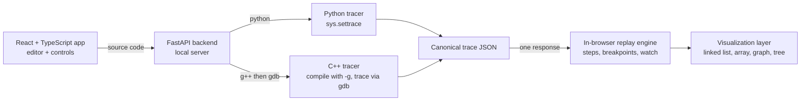

# Code Visualizer — Build Plan (v2.1)

An interactive web platform that takes unmodified source code (Python, C++) and renders its runtime execution: memory, pointers, heap, and data structures, with forward/backward stepping.

- Repo: `github.com/abdelrahman-ah1/code-visualizer` (public since Nov 23, 2026)
- Pace: ~2 hours/day, no deadline
- Status: Milestones 1 to 6 done (tracer pack, replay interface, structures view, offline export, local backend/editor, C++ via g++ + gdb, graphs and stable layout; all on `main`). Next: M7
- Updated Nov 24, 2026: M2, M3, M3.5 and M4 marked done after laptop testing.
- Revised Nov 24, 2026: applied the 9-point review (repo visibility, TypeScript, trace contract reference, softened performance claims, milestone acceptance criteria, updated open questions)

---

## 1. Goals

This one project serves four purposes, in order of arrival:

1. **Course project** — strong, demonstrable systems work.
2. **Portfolio piece** — a polished repo with a README that explains the design.
3. **Graduation project** — the final milestone (MSA CS405/CS406 track: proposal, prototype, evaluation, thesis).
4. **Product** — usable by other students and teachers once hosted.

## 2. Audience

- **Students** learning data structures and algorithms.
- **Teachers** demonstrating how code executes.
- **Interviewers** walking through a candidate's algorithm.

Python Tutor proves the demand; its weaknesses are display, UX, and long programs. Those are the gaps this project targets.

## 3. Product decisions (locked)

| Decision | Choice |
| --- | --- |
| Languages | Python and C++ first, Java later (placeholder milestone, §6) |
| Structures, in build order | Linked list → array → graph → tree |
| Code input | Paste code + built-in examples |
| Controls | Step forward, step back, speed control, breakpoints, variable watch |
| Look | Clean and minimal, with dark mode; smooth animations |
| Platform | Desktop first, phone friendly |
| Language of the UI | English |
| Frontend | React + TypeScript (no PHP, no plain JS) |
| Backend | Python + FastAPI (see §5) |
| Running mode | Local on laptop for now; hosting is an open decision (§8) |
| Tools | Free and open source only |
| Repo | Public (decided Nov 23, 2026) |

## 4. System architecture

The core idea: **trace once, replay locally.** The backend runs the program once and produces a canonical trace file. The browser replays that trace, so stepping back and forth never re-runs code and long programs stay usable.

### Components

1. **React + TypeScript app** — code editor (paste or pick an example), playback controls (step back/forward, speed, breakpoints), variable watch panel, and the canvas where structures are drawn. Desktop-first layout, responsive for phones, dark mode built in.
2. **FastAPI backend** — a small local server. It receives source code, starts the right tracer in a subprocess, and returns the trace JSON. It does no visualization itself.
3. **Python tracer** — runs the program under Python's tracing hooks and records every step: line, call stack, locals, heap objects. (Milestone 1 proved this works.)
4. **C++ tracer** — compiles the pasted code with `g++ -g` (debug info), then drives `gdb` to record the same kind of trace: lines, variables, pointers, heap. Compile typically adds a second or so for small programs.
5. **Canonical trace JSON** — one format for both languages, specified in **`TRACE_FORMAT.md`** in the repo. Every tracer emits it; the frontend only understands it. This is the contract that keeps the system decoupled. Read `TRACE_FORMAT.md` before touching capture, parsing, or replay; it is the source of truth for event timing, statuses, identity, and output semantics.
6. **Replay engine + visualization layer** — pure browser. Replays steps, animates transitions smoothly, and lays out structures so they stay stable as you step.

### Why this is fast

- The expensive part (running and tracing) happens **once**; replay is reading JSON in the browser.
- Stepping backward needs **no re-execution**: the trace is already there. It is cheap, not literally free — parsing, memory, layout, and rendering still have costs, so large traces get measured, not assumed fast.
- The backend only starts processes and moves JSON, so it is rarely the bottleneck — but it can become one (very large traces, repeated runs), which is why performance claims come with measurements, not guarantees.
- Long programs stay usable because the interface never re-runs code.

## 5. Backend decision: Python + FastAPI

Weighed on performance, since keeping the site high performance is the requirement:

| | Python + FastAPI | C++ (Crow/Drogon) |
| --- | --- | --- |
| What the backend actually does | Start tracers, move JSON — process/IO-bound work | Same |
| Where the heavy work is | In the tracer subprocess and the browser | Same |
| Raw framework speed | Fast enough; not on the hot path in normal use | Faster, but on work that rarely matters |
| Fit with the Python tracer | Native | Extra glue |
| Effort tradeoff | Leaves C++ effort for the gdb tracer, where it counts | Spends it on a layer that is rarely the bottleneck |

**Decision: Python + FastAPI.** The backend only launches tracers and passes data; replay runs fully in the browser. The C++ effort goes into the C++ tracer (g++ + gdb), which is where low-level control is actually needed. Because the trace JSON is the contract between backend and frontend, a later swap to a C++ backend would be cheap if profiling ever proves it necessary.

## 6. Milestones

Estimates are at ~2 hours/day and are planning estimates, not commitments. Each milestone lists a short "done means" summary; `agent.md` carries the detailed acceptance checks.

- [x] **M1 — Prove the trace** *(done)*: Python run captured as JSON, 10 hand-checkable test programs, passing on Python 3.12 and 3.10. Local use only; not a safe public runner.
  - Done means: the tracer, the ten baseline fixtures, and the expected-state tests are preserved and passing.
- [x] **M2 — Replay interface** *(done)*: React + TypeScript app that loads a trace JSON and replays it — step forward/back, speed control, variable display. No backend yet; traces loaded from files.
  - Done means: known fixture states render correctly (before-line timing, recursion, aliases, cycles); first/last-step boundaries, single-event and empty traces don't crash; backward stepping restores the recorded state and output without re-running code; play/pause and speed changes never skip the final state or stack up timers; malformed or partial traces get clear errors.
- [x] **M3 — Structures, animation, dark mode** *(done)*: linked list and array rendering first, smooth transitions between steps, clean minimal UI with dark mode.
  - Done means: empty and single-node structures, aliases, cycles, insertion and mutation all render correctly at desktop and phone sizes in both themes, with object positions stable across steps.
- [x] **M3.5 — Share: export session** *(after M3)*: export a session (code + trace) as a single file anyone can open and replay in their browser, no server needed. A real share link comes later, once hosting is decided (§8).
  - Done means: an exported file opens offline with everything needed for replay, and contains only the session's code, captured values, and output.
- [x] **M4 — Local backend, editor, breakpoints, watch** *(~3 weeks)*: FastAPI server, paste-your-code editor, built-in examples, breakpoints, variable watch.
  - Done means: paste code → trace → replay works end to end; breakpoints and watch operate on recorded events; file-based replay still works; API and failure paths are tested.
- [x] **M5 — C++ via g++ + gdb** *(~3 weeks, gated)*: compile with debug info, trace with gdb, emit the same trace JSON. Gated on M1–M4 feeling solid.
  - Done means: a narrow, documented C++ subset traces into the same contract, with unsupported behavior reported rather than faked.
- [x] **M6 — Graphs and trees + stable layout** *(~3 weeks)*: graph and tree rendering with layout that stays stable across steps (incremental Sugiyama/force-directed).
  - Done means: graphs and trees render with identity, cycles, and disconnected nodes correct, positions stable across steps, and the layout method chosen and profiled before any heavy dependency is added.
- [ ] **M7 — Graduation / release**: MSA learner study (evaluation), README, architecture docs, reproducible demos. The repo is already public; release readiness is a separate gate.
  - Done means: evaluation materials and results exist, the README explains the design, and demos run reproducibly from a clean checkout.
- [ ] **M8 — Java tracer (placeholder, gated)**: a Java tracer emitting the same trace JSON.
  - Gate: start only after M7, and only if Java is confirmed to be in the graduation scope. Structure and estimate to be defined when the gate opens.

## 7. Working style

- Dev tools: **Antigravity, Cursor, Copilot**, guided by `agent.md` in the repo root. Keep `agent.md` and this plan consistent when either changes.
- Code lands in the repo as **small, well-commented packs** — each pack is a few focused files you can open in Cursor.
- Every pack ships with a **short walkthrough** explaining each file, because the goal is to understand every file in the repo, not just have it work.
- Upload packs to the repo via GitHub's **Add file → Upload files**, commit to `main`.
- README is maintained as a CV/portfolio piece: what it does, the architecture, how to run it.

## 8. Open questions

- **Advisor question** *(still pending, deferred Nov 23, 2026)*: whether a project started now can be extended into the graduation project. Follow up before the CS405 proposal.
- **Hosting** *(undecided)*: when and where, once local-only is outgrown. It enables the real share link (M3.5) and the product goal (§1), so it needs a decisions-log entry once made.

Resolved since the last revision: the C++ backend question — answered in §5 (Python + FastAPI backend; C++ goes into the gdb tracer, not the web layer).

## 9. Decisions log

| Date | Decision |
| --- | --- |
| Nov 23, 2026 | Plan v2 replaces v1: all 26 answered questions folded in |
| Nov 23, 2026 | Backend: Python + FastAPI, weighed on performance (see §5) |
| Nov 23, 2026 | Architecture: trace once, replay in browser, canonical trace JSON as the contract |
| Nov 23, 2026 | Share feature added: export-to-file after M3, share link once hosted |
| Nov 23, 2026 | Dev stack: Antigravity, Cursor, Copilot; small commented packs with walkthroughs |
| Nov 23, 2026 | Repo kept public (replaces "private until the project ends"); release readiness stays a separate M7 gate |
| Nov 23, 2026 | Frontend: React + TypeScript, to satisfy the no-plain-JS requirement |
| Nov 23, 2026 | `TRACE_FORMAT.md` adopted as the source of truth for the trace contract |
| Nov 23, 2026 | `agent.md` created as the coding-agent guide; keep it consistent with this plan |
| Nov 24, 2026 | M2, M3, M3.5 and M4 marked done after laptop testing; next up is M5 (C++ via g++ + gdb) |
| Nov 25, 2026 | M5 and M6 pushed and marked done; M6 stability is hysteresis (not a freeze) and graphs are drawn only for unshared same-type neighbour lists, see WALKTHROUGH_M6.md and TEST_REPORT_M6.md; next up is M7 |
